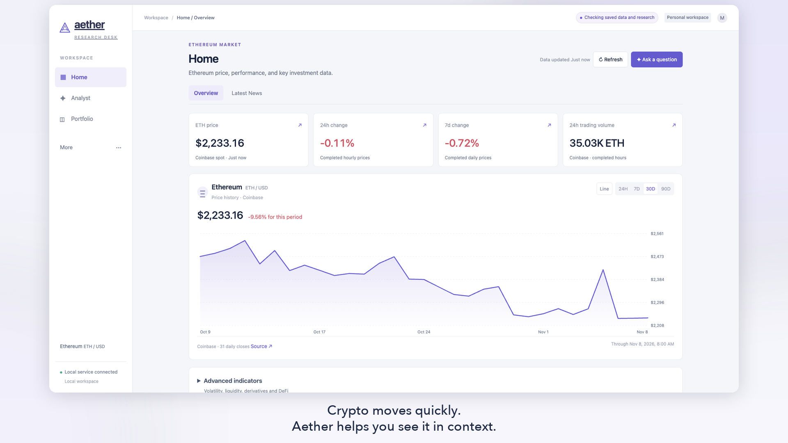
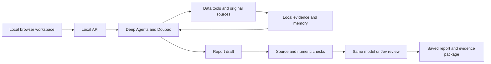

# Aether

**A local research workspace for Ethereum and Bitcoin.**

Aether brings market data, original sources, research conversations and cited
reports into one browser interface. Ask a question, request a report, inspect its
evidence, and keep your research history on your own computer.

[](docs/assets/Aether_Product_Demo_v2_1080p.mp4)

[Watch the product demo](docs/assets/Aether_Product_Demo_v2_1080p.mp4) · English
narration and subtitles. The video shows a populated workspace; a new installation
starts with empty research, data and portfolio history.

## Quick start

You need **Git**, **Python 3.12–3.14**, an internet connection, and your own
**Ark Agent Plan API key** with access to Doubao 2.1 Pro. Use macOS or Linux;
on Windows, run the project inside WSL.

```bash
git clone https://github.com/yorrkchow03/aether-research-agent.git
cd aether-research-agent
./start.sh
```

The launcher creates a local virtual environment, installs the pinned dependencies,
and asks for your API key without displaying it. It saves the key in the ignored
`.env` file, starts the local service, and opens
**[http://127.0.0.1:8765](http://127.0.0.1:8765)**.

On macOS, you can also double-click **Start_Aether.command**. Run the same launcher
again to reopen the application. Keep its terminal running; use **Ctrl+C** to stop.
Installation does not start model research, fetch market data or download optional
embedding weights.

See the [local setup guide](docs/guides/LOCAL_SETUP.md) for headless startup,
configuration, optional retrieval models and troubleshooting.

## What you can do

| Workspace | Capabilities |
| --- | --- |
| **Home** | Browse saved market facts and news with source times. Use **Refresh** to request updated research and save new material. |
| **Analyst** | Ask ordinary questions or request a scoped report. Follow research progress, continue interrupted work, and inspect saved outputs. |
| **Reports** | Read summaries, observations, developments, interpretations and limitations. Open citations, inspect calculations, export PDFs and replay evidence packages. |
| **Library** | Search source documents and data series by keywords, asset and date. Distinguish publication time, observation time and when material was actually captured. |
| **Portfolio** | Explore an editable example scenario or maintain your own local transaction ledger, CSV imports, saved valuations and purchase constraints. |
| **Strategy Lab** | Run and inspect optional prediction and strategy experiments, calibration, paper comparisons and code reviews. Results remain dated research artifacts. |

Aether also retains task notes and source memory across conversations. Keyword
retrieval works by default; optional local embeddings add semantic recall.
Independent reading agents can examine longer sources without carrying every
document into the main conversation.

Local brief and monitoring schedules are available through the scheduler API.
They run only when configured and while the local service is running.

## Your first research report

1. Start with **Home → Refresh**, or ask Analyst to collect sources for a specific
   question. The dashboard identifies unavailable or stale material.
2. Open **Analyst → Chat**, choose **New chat**, and state the asset, time window,
   timezone and scope. Click **Create report**, or explicitly ask for a report.
3. Open the result in **Reports**. Follow its citations, source timestamps and
   calculation inputs before relying on a conclusion.

For example:

> Generate a concise ETH report for the last seven completed UTC days. Use saved
> material where possible and collect only what is missing. Summarize the market
> data and major documented developments. Separate facts from interpretation,
> cite the original sources, and state any coverage gaps.

Ordinary chat remains ordinary chat. Report requests use source and numeric
checks, a separate review context, bounded revisions, and a final attempt to
deliver a smaller report containing supported findings. If the evidence cannot
support a factual result, the output identifies the gap rather than inventing
an answer. A saved review means the checks ran; it is not a guarantee that a
publisher's claims are true.

## Models and optional Jev support

The research author uses **Doubao 2.1 Pro** through Ark Agent Plan. The key belongs
to you; Aether does not provide bundled model credits.

Configuration lives in the root `.env` file. The launcher creates it from
[`.env.example`](.env.example). The main settings are:

```dotenv
AGENT_MODEL_MODE=ark_plan
ARK_API_KEY=your_ark_agent_plan_key
ARK_MODEL_ID=doubao-seed-2.1-pro
ARK_BASE_URL=https://ark.cn-beijing.volces.com/api/plan/v3
WEB_SEARCH_ENABLED=true
```

**Jev is optional** and uses a separate TypeSafe key:

```dotenv
TYPESAFE_API_KEY=your_typesafe_key
JEV_MODEL=jev-1.14.0
```

After restarting, the report composer provides two independent choices:

- **Jev source assistance** helps assess retrieved public-source passages.
- **Report review → Jev** uses Jev for source-support review while Doubao continues
  writing the report. **Same model** keeps review with the authoring model.

Enabling one does not enable the other. Both review paths retain the program's
source, timestamp, numeric and calculation checks. Model and search requests use
your provider quota; optional Jev requests use your TypeSafe account.

## How it works



The application uses Python, FastAPI, LangGraph and Deep Agents. Source snapshots,
acquisition times, structured records and calculation recipes stay available for
inspection alongside the resulting report.

## Local data and privacy

Chats, reports, evidence, memory, portfolio records and experiment artifacts are
stored locally. A fresh checkout includes application code and synthetic test
fixtures, with no personal records, downloaded datasets or prebuilt research
reports. The generated `data/`, `runtime/`, `local/` and `.env` paths are ignored
by Git.

The browser connects to a loopback service. Research requests send the relevant
prompt and source context to your configured model provider; optional public
evidence checks go to TypeSafe. This is a local application with online model and
data integrations. Research tools can execute Python and shell commands with
your local account's permissions. See [SECURITY.md](SECURITY.md) for the execution
and data boundaries.

Aether does not place trades. Portfolio scenarios and Strategy Lab results are
research tools, not verified investment performance.

## Development

After installation:

```bash
.venv/bin/python scripts/dev/check_install.py
.venv/bin/python -m unittest discover -s tests -q
```

The installation probe and automated tests use local stubs and synthetic
fixtures; they do not require a model key or paid API requests.

```text
src/research_agent/   Research harness, API, memory, reports and web interface
src/research_data/    Data collection, normalization and source library
scripts/             Local startup, data preparation and evidence tools
tests/               Automated tests and synthetic fixtures
docs/                Product, setup and architecture documentation
```

See [CONTRIBUTING.md](CONTRIBUTING.md) and
[third-party notices](THIRD_PARTY_NOTICES.md). The repository does not currently
grant an open-source license; dependencies retain their own licenses.
