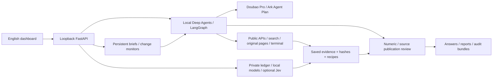

# Architecture

New developers should start with the [team handoff guide](../development/TEAM_HANDOFF.md)
and the [framework diagram](figures/aether-agent-framework-zh.png).

One loopback FastAPI application owns the local `AgentRuntime`, scheduler and investment service. Browser assets call the local API; credentials are server-side only.

Private `runtime/sessions/` holds checkpoints and task workspaces. `runtime/knowledge/` retains canonical evidence, originals and versioned news/events; SQLite FTS provides cross-session recall. Reports are context; new facts need underlying evidence. Observation and retrieval times remain separate.

The selected historical library is a source-preserving SQLite/FTS store with
content-addressed raw files. Its router keeps catalog/query scope on one explicit
window while resolving legacy monthly citation IDs. Saved query collections let
ordinary Python recipes consume long histories without losing row lineage.

Working memory stores task plans and full redacted tool artifacts; source-backed
process corrections live separately from market evidence. Native Deep Agents
compaction changes the model context while keeping original checkpoints/history.
Optional Jev sidecars classify documents, assess retrieval/relationships and
check public claims. Default shadow judgments do not change source selection or
replace the Pro publication gate. See the [implementation/usage guide](../guides/HALF_YEAR_MEMORY.md).

The harness procedure is guidance, not a fixed pipeline. Current research exposes 12 business tools plus 8 framework tools. Four skills guide market/news research, quantitative analysis, strategy experiments and portfolio analysis. A terminal Python SDK keeps source receipts while the model chooses and combines analysis code. Calculation recipes are rerun and registered with input IDs/units. See the [tool/skill contract](HARNESS.md). Host execution is not an OS sandbox; see [SECURITY.md](../../SECURITY.md).

Publication checks eligible IDs, numeric values/units and separate-context Pro source support. Reproducibility, attribution, semantic support and publisher truth are distinct. Historical reconstruction does not authenticate original publication availability. [Investment components](INVESTMENT_COMPONENTS.md) remain research aids; there is no exchange-order component.
